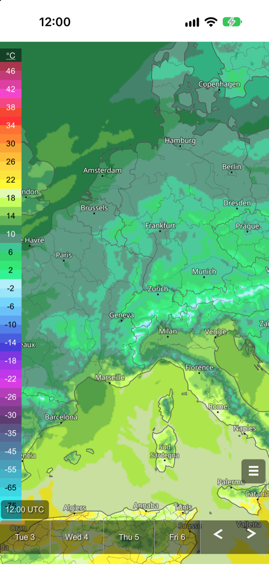

# meteoblue Maps API – iOS WebView example

A minimal iOS app (SwiftUI) that shows meteoblue weather maps with the
[meteoblue Maps Plugin](https://docs.meteoblue.com/en/weather-apis/maps-api/maps-plugin) inside a `WKWebView`.
The plugin provides the complete user interface: map menu, time selection and legend.

The app consists of two files:

- [`map.html`](MapsAPIWebView/map.html): loads Mapbox GL JS v1 and the Maps Plugin from meteoblue servers and
  initializes the plugin with an Inventory URL (`https://maps-api.meteoblue.com/v1/map/inventory/filter?maps=...`),
  which defines the maps shown in the menu
- [`MapWebView.swift`](MapsAPIWebView/MapWebView.swift): shows `map.html` from the app bundle in a `WKWebView`

## Run

Open `MapsAPIWebView.xcodeproj` in Xcode and run the `MapsAPIWebView` scheme.
To run on a device, select your development team under *Signing & Capabilities*.

## API key

The app uses a rate-limited demo API key, which will be replaced from time to time.
Get your own API key [here](https://content.meteoblue.com/en/access-options/meteoblue-weather-api)
and set `apiKey` in `map.html`.

## Documentation

- [Maps API overview](https://docs.meteoblue.com/en/weather-apis/maps-api/overview)
